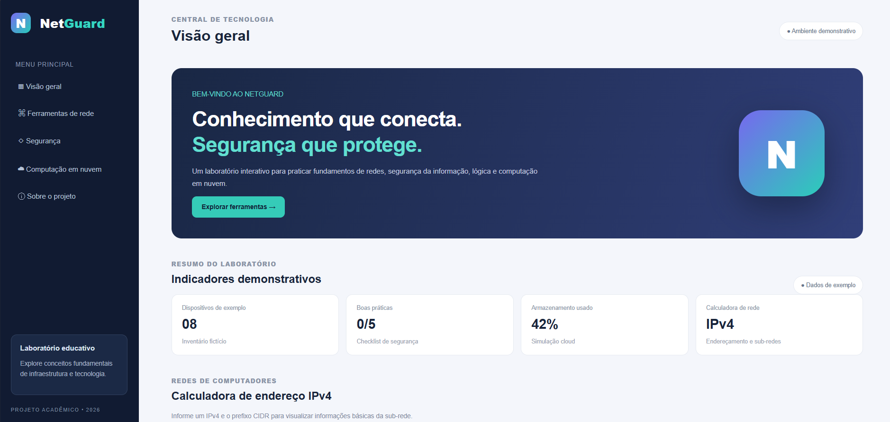

# 🛡️ NetGuard — Central de Monitoramento de TI

O **NetGuard** é um projeto acadêmico e educativo que reúne conceitos introdutórios de Redes de Computadores, Segurança da Informação, Matemática e Lógica, Programação e Computação em Nuvem em um painel interativo.

> **Aviso:** é uma simulação para fins de estudo. Não monitora redes reais, não realiza testes de invasão e não audita a segurança de dispositivos.

## Funcionalidades

- Calculadora IPv4/CIDR: endereço de rede, broadcast, máscara e quantidade de hosts.
- Checklist de boas práticas de segurança.
- Simulador de armazenamento em nuvem: espaço utilizado, disponível e percentual.
- Interface responsiva para computador e celular.
- Validação de dados e cálculos em JavaScript.

## Relação com as disciplinas do primeiro período

| Disciplina | Aplicação |
|---|---|
| Introdução à Programação de Computadores | Variáveis, funções, condicionais, eventos e validação |
| Fundamentos de Redes de Computadores | IPv4, máscara, CIDR, rede e broadcast |
| Introdução à Segurança da Informação | Checklist de boas práticas |
| Matemática e Lógica | Cálculos de sub-rede, capacidade, porcentagem e validações |
| Computação em Nuvem | Simulação de capacidade e consumo de armazenamento |

## Tecnologias

- HTML5
- CSS3
- JavaScript puro (sem frameworks ou dependências)

## Como executar

1. Baixe ou clone o repositório.
2. Abra a pasta do projeto.
3. Abra `index.html` em seu navegador.

Não é necessário instalar dependências nem configurar servidor.




## Estrutura

```text
NetGuard-Protecao-de-Rede--main/
│
├── README.md
│
└── NetGuard-Protecao-de-Rede--main/
    ├── README.md
    ├── Index.html
    ├── JS/
    ├── css/
    └── assets/
        └── netguard.png.png
